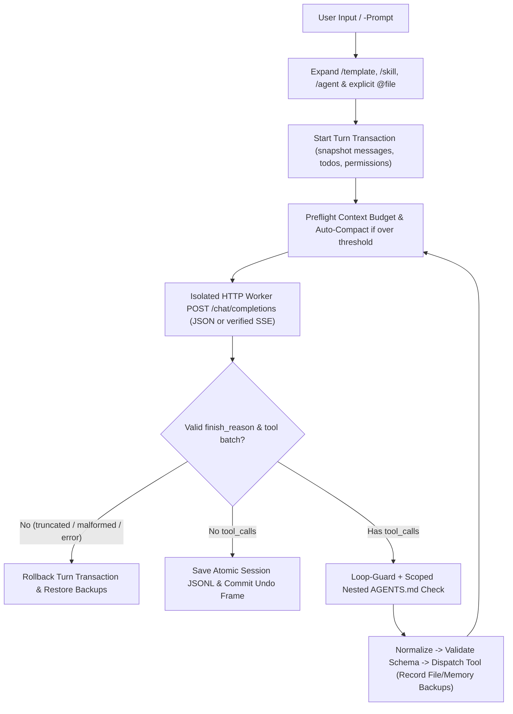

# Architecture & Build Pipeline

`shellossus` uses a **dual-distribution architecture**: contributors work in 36 small, focused PowerShell modules under [`src/`](../src/), while [`build.ps1`](../build.ps1) compiles them into the standalone, pure 7-bit ASCII [`shellossus.ps1`](../shellossus.ps1) artifact in the repository root.

This design gives maintainers clean separation of concerns and fast unit testing without sacrificing single-file deployment on locked-down Windows desktops, Citrix/VDI sessions, and jump hosts.

---

## Module Map (`src/` -> `shellossus.ps1`)

`build.ps1` concatenates the 36 modules below in exact dependency order and fails if any `.ps1` file under `src/` is unlisted or contains non-ASCII characters:

### 1. Core Foundation & Theme
- **[`src/Config.ps1`](../src/Config.ps1):** Plain-data `SHELLOSSUS_*` config parser/writer (`Read-AgentConfig`, `Save-AgentConfig`), private ACL/mode checks (`Test-AgentConfigPrivacy`), `ConstrainedLanguage`-safe temp/UTF-8 helpers (`New-AgentTempFile`, `Set-AgentUtf8Content`), workspace path & reparse-point enforcement (`Resolve-AgentPath`, `Test-PathHasReparsePoint`), and `.env` secret blocking (`Test-IsSecretFile`).
- **[`src/Theme.ps1`](../src/Theme.ps1):** 9 built-in 24-bit TrueColor palettes (`gruvbox-material` default, `catppuccin-mocha`, `tokyo-night`, `dracula`, `nord`, `one-dark`, `rose-pine`, `kanagawa`, `catppuccin-latte`), palette switching (`Set-AgentTheme`), and terminal box-drawing glyphs.

### 2. Terminal UI (`src/ui/`)
- **[`src/ui/Ansi.ps1`](../src/ui/Ansi.ps1):** ANSI escape stripping/wrapping, terminal width detection (`Get-TerminalWidth`), framed card boxes (`Format-TuiCardBox`), context token gauge, permission badges, and REPL prompt frame (`Write-TuiPromptFrame`).
- **[`src/ui/Cards.ps1`](../src/ui/Cards.ps1):** Tool execution cards, `todo` task boards, `ask_user` plan review cards, memory cards, and unified diff formatting (`Format-UnifiedDiff`).
- **[`src/ui/Input.ps1`](../src/ui/Input.ps1):** Multi-line fenced/paste input (`Read-TuiMultilineInput`), interactive numbered/fuzzy selector (`Invoke-TuiSelector`), and confirmation prompts (`Read-TuiConfirmation`).
- **[`src/ui/Markdown.ps1`](../src/ui/Markdown.ps1):** Markdown headings, lists, code blocks, inline styles, visible-width-aligned tables (`Get-VisibleLength`, `Format-MarkdownTable`), `reasoning_content` blocks (`Write-AgentReasoning`), and the half-block pixel mascot (`Write-TuiMascotCard`).

### 3. Tool Runtime & Built-in Tools (`src/tools/`)
- **[`src/tools/Common.ps1`](../src/tools/Common.ps1):** Scoped execution state snapshot/restore (`Get-AgentExecutionContext`, `Restore-AgentExecutionContext`), canonical tool aliases (`Resolve-ToolCanonicalName`), tool filter checks (`Test-IsToolEnabled`), `ConstrainedLanguage`-safe file digests, output truncation, and runtime inspection (`Get-AgentEnvironment`).
- **[`src/tools/Schemas.ps1`](../src/tools/Schemas.ps1):** Single source of truth for OpenAI function schemas and parameter rules (`Get-AgentToolSpecifications`, `Get-AgentTools`, `Get-AgentCapabilities`).
- **[`src/tools/Normalizers.ps1`](../src/tools/Normalizers.ps1):** Tolerant parameter alias/camelCase normalizers prior to validation (`Format-AgentToolArguments`).
- **[`src/tools/Validation.ps1`](../src/tools/Validation.ps1):** Strict pre-execution schema, required-field, type, and custom constraint validation (`Test-AgentToolArguments`).
- **[`src/tools/Ignore.ps1`](../src/tools/Ignore.ps1):** Hierarchical `.gitignore` / `.ignore` / `.fdignore` compiler, turn-scoped directory walk cache, and workspace traversal (`Invoke-WorkspaceWalk`).
- **[`src/tools/Files.ps1`](../src/tools/Files.ps1):** Encoding/BOM round-trip detection, exact/CRLF/fuzzy line matching (`Find-EditMatch`), bottom-to-top batch edits, and staged transactional writes (`Invoke-AgentWrite`, `Invoke-AgentEdit`).
- **[`src/tools/Search.ps1`](../src/tools/Search.ps1):** Read-only inspection tools: `Invoke-AgentListFiles`, `Invoke-AgentFindFiles`, `Invoke-AgentGrepFiles` (with literal prefiltering and regex timeouts), and line/character-paginated `Invoke-AgentReadFile`.
- **[`src/tools/Shell.ps1`](../src/tools/Shell.ps1):** Sanitized child PowerShell execution, disk-backed stdout/stderr logs, and PID/start-time descendant tree termination (`Invoke-ShellCommand`, `Invoke-AgentCommand`).
- **[`src/tools/Undo.ps1`](../src/tools/Undo.ps1):** Verified backup creation, reverse-chain preflight validation, manual-edit conflict detection, turn transaction rollback, and recovery manifests (`Invoke-AgentUndo`, `Undo-AgentTurnTransaction`).
- **[`src/tools/Web.ps1`](../src/tools/Web.ps1):** SSRF IP/DNS preflight (`Assert-SafeWebResolution`), web confirmation prompts, isolated `web` download worker, HTML-to-text extraction, and `Invoke-AgentFetchUrl`.
- **[`src/tools/WebSearch.ps1`](../src/tools/WebSearch.ps1):** Pure-PowerShell UTF-8 percent-encoding/decoding and HTML search result extraction (`Invoke-AgentWebSearch`).
- **[`src/tools/Todo.ps1`](../src/tools/Todo.ps1):** Session task board tool (`Invoke-AgentTodo`).
- **[`src/tools/AskUser.ps1`](../src/tools/AskUser.ps1):** Interactive user question and strict plan-approval tool (`Invoke-AgentAskUser`).
- **[`src/tools/Memory.ps1`](../src/tools/Memory.ps1):** Workspace and global `MEMORY.md` tool with staged writes, backups, and live system-prompt sync (`Invoke-AgentMemory`).
- **[`src/tools/AgentWorkers.ps1`](../src/tools/AgentWorkers.ps1):** Internal `subagent` worker entrypoint (`Invoke-InternalSubagentWorker`), aggregate status resolution, and parallel `ReadOnly` worker process pool.
- **[`src/tools/Agents.ps1`](../src/tools/Agents.ps1):** Scoped in-process subagent execution, forked history boundary slicing, and `run_agent` orchestration (`single`, `parallel[]`, `pipeline[]`).
- **[`src/tools/Dispatch.ps1`](../src/tools/Dispatch.ps1):** Master tool call router (`Invoke-AgentTool`).

### 4. Context, Session Tree & Compaction (`src/context/`)
- **[`src/context/Prompt.ps1`](../src/context/Prompt.ps1):** Layered system prompt builder (`Build-SystemPrompt`), path-scoped nested `AGENTS.md` loader (`Get-ScopedAgentInstructions`), and live capability/memory synchronization (`Sync-AgentCapabilities`, `Sync-AgentMemoryContext`).
- **[`src/context/Catalog.ps1`](../src/context/Catalog.ps1):** Discovery and slash-command expansion for `SKILL.md` skills and built-in/custom subagent roles (`Get-SkillsCatalog`, `Get-AgentRolesCatalog`).
- **[`src/context/Templates.ps1`](../src/context/Templates.ps1):** Single-pass argument expansion for `.shellossus/prompts/*.md` (`Expand-TemplateArgs`) and explicit user `@file` attachment injection (`Expand-UserPrompt`).
- **[`src/context/SessionTree.ps1`](../src/context/SessionTree.ps1):** Parent-linked conversation DAG (`id`, `parent_id`), valid tool-boundary checks (`Test-ValidConversationBoundary`), and branch context reconstruction (`Switch-SessionBranch`, `Build-BranchContextMessages`).
- **[`src/context/Session.ps1`](../src/context/Session.ps1):** Atomic workspace-scoped JSONL persistence (`Save-AgentSession`), import/resume validation (`Invoke-SessionResume`), `/fork` (`Invoke-SessionFork`), and standalone themed HTML export (`Export-AgentSessionHtml`).
- **[`src/context/Compaction.ps1`](../src/context/Compaction.ps1):** Token estimation, preflight context budgeting, constraint-preserving history summarization, and cumulative `<read-files>` / `<modified-files>` handoff entries (`Invoke-AgentCompact`).

### 5. Diagnostics & CLI Runtime (`src/Doctor.ps1`, `src/cli/`, `src/Cli.ps1`)
- **[`src/Doctor.ps1`](../src/Doctor.ps1):** Non-mutating runtime, configuration, workspace, session-storage, and `GET /models` health diagnostics (`Get-AgentDoctorReport`, `Write-AgentDoctorReport`).
- **[`src/cli/Install.ps1`](../src/cli/Install.ps1):** `$PROFILE` launcher installer (`Invoke-AgentProfileInstall`) with `Get-Command -All` shortcut conflict checks.
- **[`src/cli/Http.ps1`](../src/cli/Http.ps1):** API message sanitization, pure-ASCII JSON escaping, JSONL event writer (`Write-AgentJsonEvent`), isolated `http` worker, transient retry/backoff loop, and strict SSE response assembler (`ConvertFrom-AgentSseResponse`).
- **[`src/cli/Turn.ps1`](../src/cli/Turn.ps1):** Core agent turn loop (`Invoke-AgentTurn`, `Invoke-AgentContinue`): preflight budget check, auto-compaction on context overflow, `finish_reason` and tool-batch validation, repetition loop-guard, scoped `AGENTS.md` gating, and tool dispatch.
- **[`src/cli/Repl.ps1`](../src/cli/Repl.ps1):** Slash-command alias resolver (`Resolve-ReplCommandAlias`), status/tree/help/skills/agents cards, `/memory` parser, and interactive pickers (`/permission`, `/reasoning`, `/context`, `/model`, `/theme`).
- **[`src/cli/Commands.ps1`](../src/cli/Commands.ps1):** Interactive REPL handlers for `/new`, `/todo`, `/name`, `/tree`, `/fork`, `/export`, `/import`, `/copy`, `/reload`, `/save`, `/undo`, `/compact`, `/sessions` / `/resume`, `/continue`, and `!` / `!!`.
- **[`src/Cli.ps1`](../src/Cli.ps1):** Top-level entrypoint dispatching `-InternalWorker`, `-Install`, `-Setup`, `-Mascot`, `-Doctor`, `-Export`, single-shot `-Prompt`, and the interactive REPL loop wrapped in turn transactions.

---

## Agent Turn Lifecycle

---

## Built-in Tool Reference

All 13 canonical tools defined in [`src/tools/Schemas.ps1`](../src/tools/Schemas.ps1) (subject to active `-Permission` and `-Tools` / `-ExcludeTools` / `-NoTools`):

| Tool | Purpose | Filesystem & Undo Scope |
| :--- | :--- | :--- |
| `list_files` | List directory entries | Workspace; read-only |
| `read_file` | Read text with 300-line / 20k-char & `start_char` pagination | Workspace + registered global `SKILL.md`; read-only |
| `find_files` | Glob file search honoring `.gitignore` / `.ignore` / `.fdignore` | Workspace; read-only |
| `grep_files` | Regex/literal search with context & `file_offset` + `start_line` continuation | Workspace; read-only |
| `write_file` | Create or overwrite a text file (staged, encoding-preserving) | Workspace; tracked by `/undo` |
| `edit_file` | Exact, CRLF, or fuzzy replacement + bottom-to-top batch `edits[]` | Workspace; tracked by `/undo` |
| `run_command` | Execute PowerShell with timeout, tree cleanup, and `.shellossus/output/` logs | User OS permissions; outside `/undo` |
| `run_agent` | Single, `parallel[]` (`ReadOnly`), or `pipeline[]` subagent delegation | Clamped to parent permissions; in-process edits join `/undo` |
| `fetch_url` | Fetch HTTP(S) page text with SSRF preflight and 2 MiB cap | Outbound network; outside `/undo` |
| `web_search` | Query web search results with SSRF preflight | Outbound network; outside `/undo` |
| `todo` | Update the structured session task checklist | Saved in session JSONL; restored by `/undo` |
| `ask_user` | Ask multiple-choice questions or request explicit plan review | Interactive UI; outside `/undo` |
| `memory` | `view`, `append`, `set`, or `clear` workspace/global `MEMORY.md` | Fixed memory paths; tool writes tracked by `/undo` |

---

## Build & Verification Pipeline

1. **Edit modular sources** in [`src/`](../src/).
2. **Bundle the artifact** via `.\build.ps1`, which validates 7-bit ASCII across `build.ps1`, `src/*.ps1`, and `tests/*.ps1`, ensures every `src/**/*.ps1` file is listed in `$modules`, normalizes line endings to LF, and writes [`shellossus.ps1`](../shellossus.ps1).
3. **Run the verification suite** via `.\tests\smoke.ps1`:
   - Runs `.\build.ps1 -Check` to confirm `shellossus.ps1` is byte-for-byte in sync with `src/*.ps1`.
   - Executes all modular suites (`Config.Tests.ps1`, `Theme.Tests.ps1`, `Tools.Tests.ps1`, `Context.Tests.ps1`, `Cli.Tests.ps1`, `Doctor.Tests.ps1`, `Reliability.Tests.ps1`) using shared helpers in [`tests/TestHelpers.ps1`](../tests/TestHelpers.ps1) and isolated temporary directories (all HTTP calls mocked).
   - Re-runs `Doctor.Tests.ps1 -ConstrainedLanguage` and `Reliability.Tests.ps1 -ConstrainedLanguage` inside fresh `ConstrainedLanguage` child processes.
   - Executes `ConstrainedLanguage.Tests.ps1`, including a cold-start child process that switches to `ConstrainedLanguage` on line 1 before dot-sourcing `shellossus.ps1`.

CI ([`.github/workflows/check.yml`](../.github/workflows/check.yml)) runs `tests/smoke.ps1` on Windows PowerShell 5.1 (`windows-latest`) and PowerShell 7 (`pwsh`) across Windows, Linux, and macOS.
